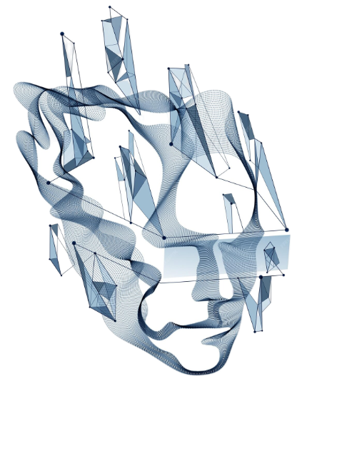

# 0en

I'm Anton, software architect, protocols engineer and forward-thinker with over 25 years of experience in designing and implementing scalable software systems. 

I specialize in Conformance Protocols, AI-first
Architectures and open-source development. My passion lies in leveraging technology to solve complex societal challenges and drive human progress.

I develop AI-first architectures, Self-Sovereign Identity, Agentic security, Conformance protocols, AI alignment, Eval and QA.

<a href="./PRINCIPLES.md">Principles</a> •
<a href="./PHILOSOPHY.md">Philosophy</a> •
<a href="./INNOVATIONS.md">Innovations</a> 

---
Innovations:

[N-ORG](./innovations/n-org.md) •
[Mutualism](./posts/mutualism.md) •
---

<b>Current loop:</b>

  

<a href="https://github.com/anton-ecom/conformance/">Code Conformance Protocol</a>

Policy as the source of truth for the code

  

<a href="https://github.com/synthetism">Synthetism</a>

Open Standards & SSI

 

  

<a href="https://github.com/privatekeyid">PrivateKey</a>

Private key security architecture

---

Poetry:
[Synthetic Mind Dream](./poetry/synthetic-mind-dream.md)

Dev Art: 
[I write code](./posts/i-write-code.md) •
[Fit or Fly](./posts/fit-or-fly.md) •
[Vibe Food](./posts/vibe-food.md) •
[50 years of closed](./posts/50-years-of-closed.md)

---

>We either make history or become history.
>
>(c) 0en 

  

